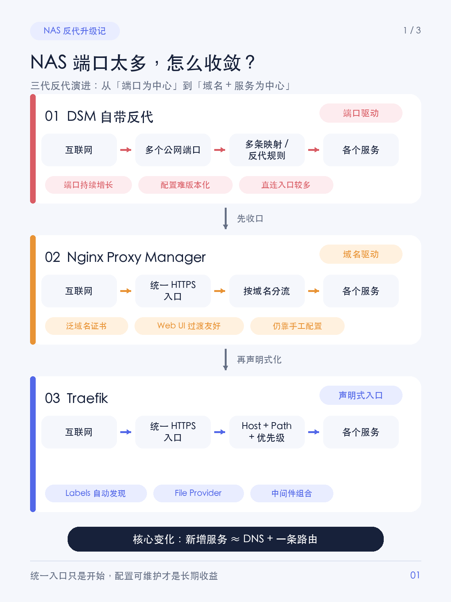
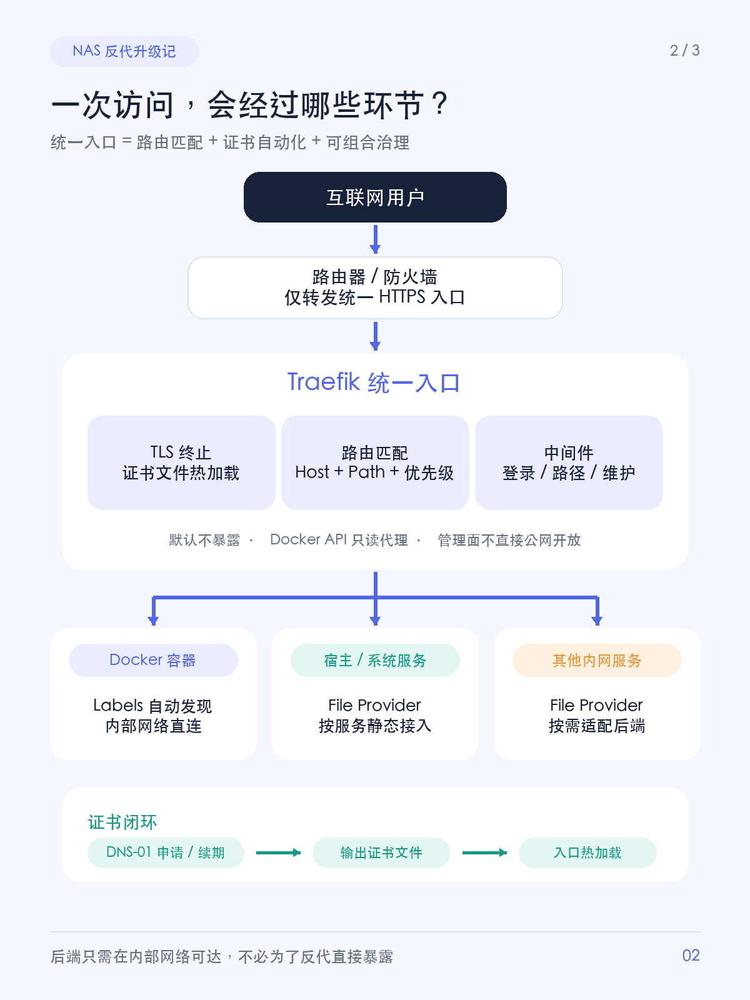
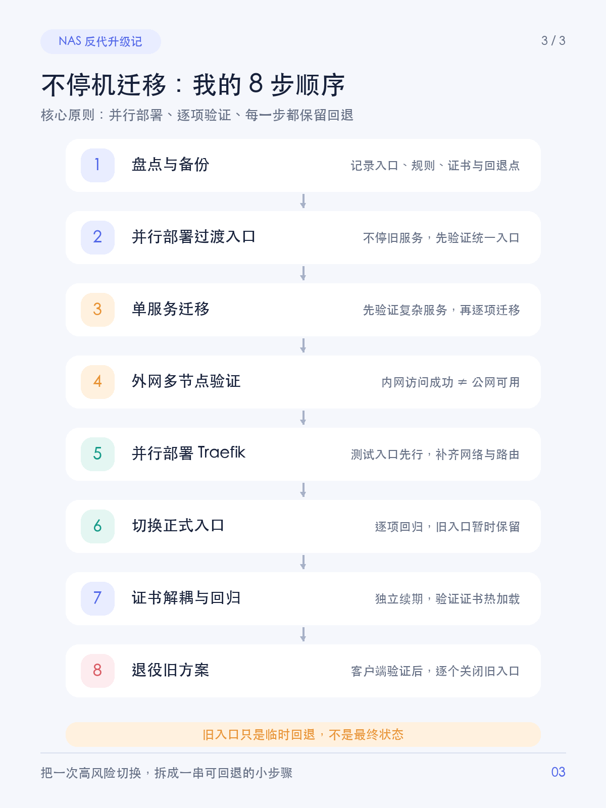

# 小红书发布稿｜NAS 反向代理演进

## 标题备选

1. NAS端口太多，我把主入口收敛成1个
2. 从端口地狱到统一入口：我的 NAS 反代升级记
3. DSM → NPM → Traefik，NAS 反代终于理顺了

## 封面文案

**NAS 暴露端口太多了**

主入口从 11+ 个收敛到 1 个

## 正文

起因很直接：NAS 暴露到外面的端口太多了。

每多一个服务，就可能多一个公网端口、一条路由器映射和一套证书配置，有些容器甚至还留着直连 HTTP 入口。服务越堆越多，端口越来越难盘，安全边界也越来越模糊。

这次的目标很明确：**收敛公网端口，让 Web 服务只走一个统一 HTTPS 主入口。**

不是 nginx 不够强，而是“一个服务一个端口”的模型，服务一多就很容易失控。

这次我没有一步到位，而是经历了三个阶段👇

### ① DSM 自带反代：能用，但围着端口转

优点是图形界面简单，少量服务很省心。

但服务变多后，问题越来越明显：公网端口不断增加、配置不方便 diff 和回滚、证书与规则绑定、入口和 DSM 强耦合。后端为了被反代，还得把端口发布到宿主机，直连入口也可能顺带暴露。

### ② NPM：先把入口收拢

Nginx Proxy Manager 帮我验证了两件事：

✅ 一个统一 HTTPS 入口，可以按域名分流

✅ DNS-01 可以申请泛域名证书，不依赖公网标准 Web 端口

迁移体验很友好，适合过渡期。但每个服务仍要手工建 Proxy Host，配置主要存在 UI 和数据库里，也没有 Docker 自动发现。服务继续增加后，维护成本还是会回来。

### ③ Traefik：把入口变成“声明式配置”

最后迁到 Traefik，看中的不只是反代，而是整套入口模型：

🔹 Docker Labels：路由跟着服务走，容器重建后自动发现

🔹 File Provider：接入宿主机、系统套件和其他内网服务

🔹 中间件：统一登录、路径处理、维护模式都能组合

🔹 配置文本化：可以备份、diff、评审和回滚

🔹 证书独立：由独立组件申请和续期，Traefik 读取并热加载

现在新增一个 Docker 服务，基本就是“确认 DNS + 加一条路由”，不再需要新增公网端口映射。

### 我没有“大爆炸切换”

整个迁移按这个顺序走：

盘点备份 → 并行部署过渡入口 → 单服务迁移 → 外网多节点验证 → 并行部署 Traefik → 切换正式入口 → 证书解耦与全量回归 → 退役旧方案

旧入口只作为临时回退。等客户端、大文件、Git 操作等验证完成，再逐个关闭，才算真正完成安全收尾。

### 踩坑记录，建议你提前收藏

⚠️ NAS 里访问公网域名成功，不代表公网真的能访问，可能只是 NAT 回环成功。

⚠️ 后端报 502，不一定挂了，也可能是 Host 头校验、跨 Docker 网络或协议配置问题。

⚠️ 应用里配置的对外地址也要同步修改，否则重定向、Webhook、预签名链接可能出错。

⚠️ 自签证书的后端要单独处理，别图省事全局关闭证书校验。

⚠️ 普通 HTTP 反代不是万能入口，SSH、SMB、NAS 同步等流量仍需要独立方案。

### Traefik 也不是“闭眼升级”

它的概念更多，Labels 写错有时只是悄悄少一条路由；官方管理面也不如 NPM 开箱即用。统一入口、证书组件和自建管理页，都要纳入备份、健康检查和告警。

所以我的建议是：

🔸 只有少量服务：DSM 自带反代或 NPM 就够用

🔸 想快速统一入口：NPM 很合适

🔸 服务持续增长，想要自动发现、配置即代码和统一治理：再考虑 Traefik

这次升级最大的收益，不是少开了几个端口，而是入口终于从“靠记忆维护”变成了“可描述、可验证、可回滚”。

你现在在用 DSM 自带反代、NPM，还是 Traefik？评论区聊聊你的方案👇

## 话题标签

#NAS #群晖 #Traefik #NginxProxyManager #Docker #反向代理 #Homelab #自托管 #运维 #技术分享

---

## 配图顺序（不随正文发布）

1. `01-evolution.png`：三代架构演进，放在三个阶段介绍之后。
2. `02-request-flow.png`：统一入口请求链路，放在 Traefik 介绍之后。
3. `03-migration.png`：平滑迁移流程，放在迁移步骤之后。

## 脱敏说明（不随正文发布）

已移除真实域名、IP 地址、业务端口、文件目录、Docker 网络名、路由器型号、备份文件名及证书具体日期；保留软件名、通用协议名和架构概念。流程图同样使用通用角色与能力描述，不含可反推真实环境的信息。
